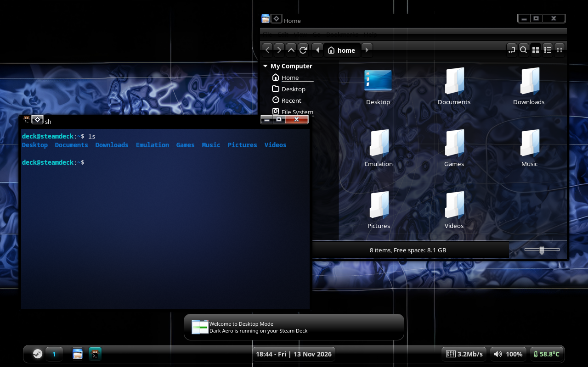
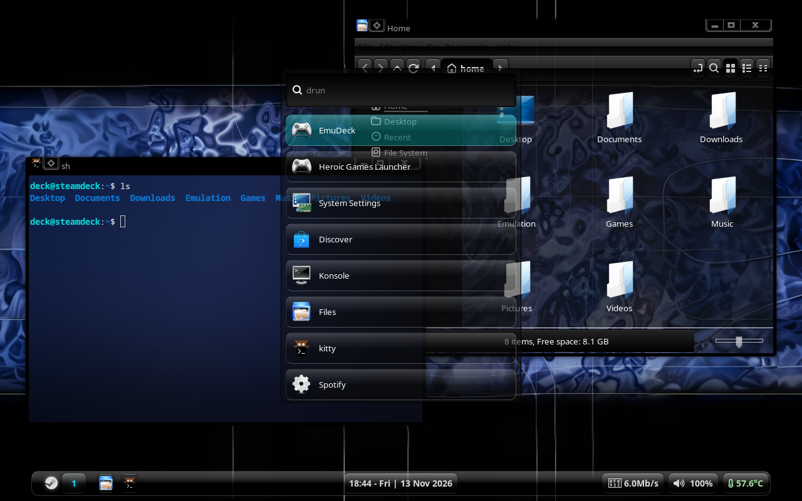

# deck-aero

My Dark Aero Hyprland desktop, ported to the Steam Deck's Desktop Mode.





*These are rendered at the Deck's 1280×800 resolution, in a test KDE session running this repo's files. The icons in them are from my PC; on the Deck you keep your own icon pack.*

It runs your **actual waybar, swaync and wofi configs** on the Deck's KDE desktop, instead of a Plasma panel made to look similar. They run inside a distrobox container, so SteamOS updates don't wipe them.

| Piece | On the Deck |
|---|---|
| Bar | real waybar, same `style.css`; workspaces + taskbar fed from KWin by a small bridge |
| Notifications | real swaync, same config/style (Plasma's popups are switched off) |
| Launcher | real wofi, same style — the Steam button on the bar opens it |
| Wallpaper | same image, cover-fit |
| Windows | Classic-Black: the classic frame from my Deck, done in the black split gloss of my Firefox and Nemo themes, with Nemo-style glossy buttons. It's generated by `tools/make-classic-black.py` |
| Qt/KDE apps | Dark Aero colour scheme + Fusion |
| GTK apps | diinki-aero theme, also forced onto Flatpak apps |
| Icons / cursor | **keeps the Deck's own icon pack** (GTK apps, the launcher and taskbar follow it) / WoW cursors |
| Terminal / files | kitty (same config, blurred) and Nemo, from the container |
| Firefox | transparent Aero `userChrome.css` + prefs (automatic); Stylus site themes in `apps/firefox/stylus/` (YouTube, Roblox, Instagram); Tampermonkey script in `apps/firefox/userscripts/` (Instagram DMs laid out like Discord) |
| Discord | Dark Aero quickCSS (Vesktop or Vencord) |
| Spotify | Spicetify DarkAero (optional, `--spotify`) |
| On-screen keyboard | Deckboard: a smaller Aero-styled keyboard driven by the trackpads; X shows it, ⋯ opens the launcher. Source and setup in [`apps/deckboard/`](apps/deckboard/) |

## Install (on the Deck)

1. Switch to **Desktop Mode** and open **Konsole**.
2. Run:
   ```sh
   git clone https://github.com/kriistine/deck-aero.git ~/deck-aero
   cd ~/deck-aero && ./install.sh
   ```
   Add `--spotify` to also theme Spotify. That step asks for your sudo password; if you've never set one, run `passwd` first.

Waybar needs the **Wayland** desktop session. If your Desktop Mode is X11, the installer tells you how to switch, and you run it again afterwards.

To get Firefox and Discord themed, open each app once first, then run `./install.sh` again. Running it again is always safe.

## Using it

- **Steam button** (left of the bar): opens the app launcher. Click it again to close.
- **Right-click the Steam button, or click the clock**: opens the notification center.
- **Taskbar icons**: click to focus or minimize, middle-click to close.
- **Workspace numbers**: click to switch. There are 4 desktops.
- **Return to Gaming Mode**: it's in the launcher.

## Undo

```sh
~/deck-aero/uninstall.sh
```

This restores your previous Plasma panel, colours and configs, and deletes the container.

## How the bar works on KDE

waybar's `hyprland/workspaces` and `wlr/taskbar` modules need Hyprland or wlroots. KWin doesn't support those, so:

- `files/.local/share/deckaero/kwin/bridge.js` runs inside KWin and sends the window and desktop list over D-Bus whenever something changes.
- `files/.local/share/deckaero/bin/bridge.py` receives that list. It draws each window as a PNG button styled like the `#taskbar button` CSS, with the cyan gradient when active, and signals waybar to refresh.
- In waybar, `group/workspaces` and `group/taskbar` keep the ids `#workspaces` and `#taskbar`, so the original CSS still applies.
